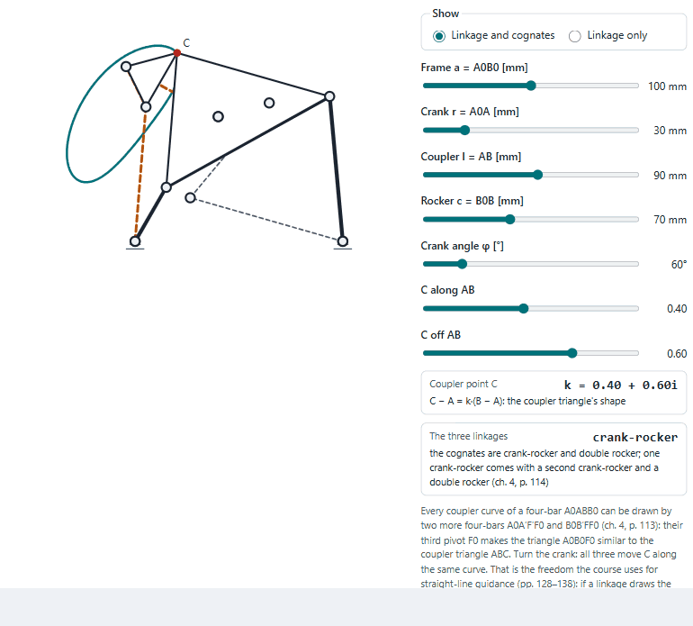

# Master lectures aid kit

Interactive labs for the FH Technikum Wien master's lectures, where you move a slider and watch the lecture's own
equations work. The same build as the [Bachelor lectures aid kit](https://github.com/Abdulhamid-Baghdadi/bachelor-lectures-aid-kit).

Published at <https://abdulhamid-baghdadi.github.io/master-lectures-aid-kit/>.

<picture>
  <source media="(prefers-color-scheme: dark)" srcset="handling-lab/docs/coupler-dark.gif">
  
</picture>

## The labs

| Lab | Course | After |
|---|---|---|
| [Industrial Handling](handling-lab/README.md) | Industrial Handling (IHA, Handhabungstechnik), 3rd semester | Berger (2021) |
| [Robot Kinematics](robotics-lab/README.md) | Industrieroboter (IRB), 1st semester | the IRB chapters and the ABB IRB 120 spec |
| [Mobile Robots and Vision](mobile-robots-lab/README.md) | Mobile und Service Robotik (MUS, MUS2), 2nd and 3rd semester | the MUS and MUS2 slides |
| [Sensor Systems](sensors-lab/README.md) | Advanced Sensor Systems (ASENS), 1st semester | the ASENS slides |
| [Finite Elements](fem-lab/README.md) | CAE and FEM, 2nd semester | Krach (2018, 2020, 2021) |
| [Advanced Automation](automation-lab/README.md) | AAU, 2nd semester: the exercises, step by step, with their MATLAB | Kubinger (2021), Kubinger and Lang (2021) |
| [ModSim](modsim-lab/README.md) | Modellbildung und Simulation, 2nd semester: the worked examples, step by step, with their MATLAB | Puhwein (2021a, 2021b) |

Industrial Handling has 11 labs in three parts:

- **Linkages:** the mobility count, Grashof's rule, the transmission angle, instant centres, dead-centre synthesis,
  two-position synthesis, and coupler curves with their cognates.
- **Motion design, cams and indexing:** motion laws, the disc cam and the indexing cam.
- **Grippers:** suction and magnet grippers.

## How to open it

Serve the folder and open the start page:

```bash
python -m http.server 8772 --bind 127.0.0.1
```

then <http://127.0.0.1:8772/>. The labs are ES modules, so opening `index.html` straight from the disk does not work.
Tests: `node --test` in `kit`, and `node --test "tests/unit/*.test.js"` in each lab folder.

## Where your data stays

Everything runs in your browser. Nothing is sent anywhere; the only thing kept is your light or dark choice.
