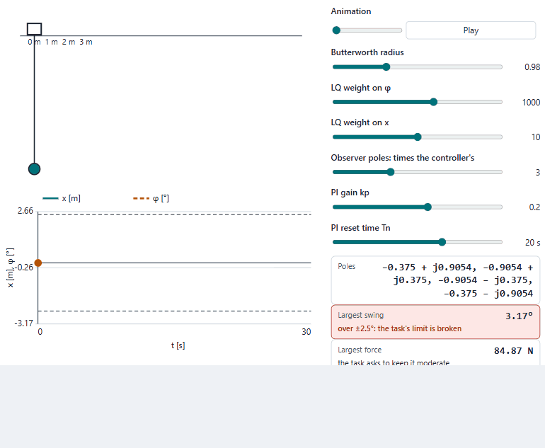
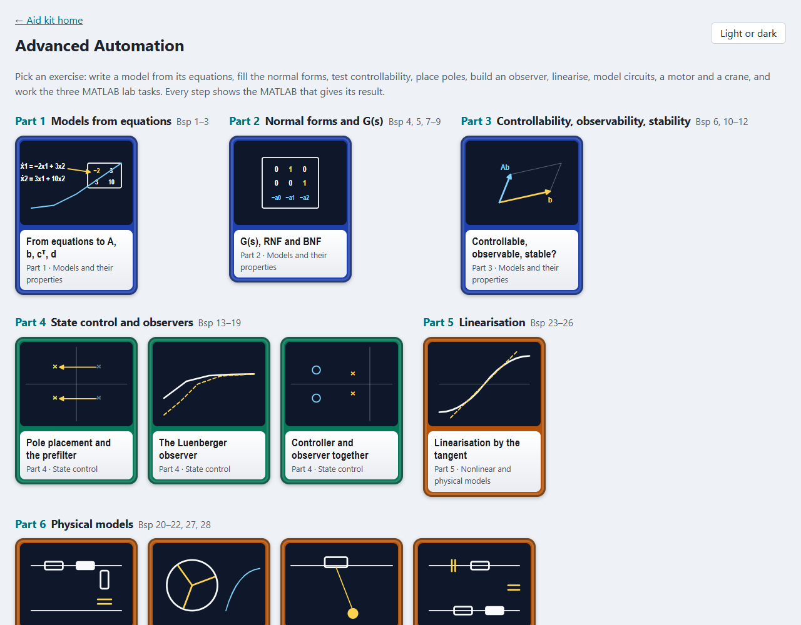
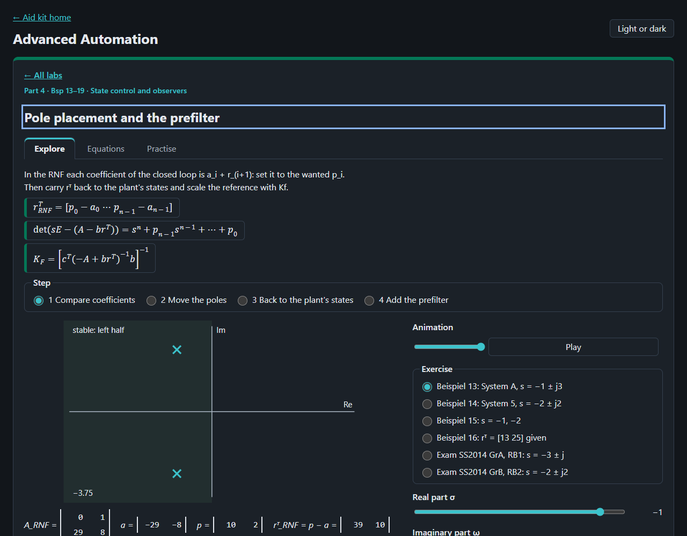

# Advanced Automation

The exercises of Advanced Automation (AAU, FH Technikum Wien, summer term 2021) animated step by step: the 28
Rechenbeispiele of Kubinger (2021a) and the three MATLAB lab tasks of Kubinger (2021b) and Kubinger and Lang (2021).
Every step of every exercise is a view of its own, and every view shows the MATLAB that gives its result, written from
the view's current values.

<picture>
  <source media="(prefers-color-scheme: dark)" srcset="docs/crane-dark.gif">
  
</picture>

## What is in it

| Part | Labs (exercises) |
|---|---|
| 1 Models from equations | the coefficients go into A, b, cᵀ, d (and B, C, D), a step, the free motion (Bsp 1–3) |
| 2 Normal forms and G(s) | G(s) from (sE − A)⁻¹, RNF and BNF filled cell by cell, the same step for every form (Bsp 4, 5, 7–9) |
| 3 Controllability, observability, stability | b and Ab spanning the plane, cᵀ and cᵀA, the poles and the free motion (Bsp 6, 10–12) |
| 4 State control and observers | coefficient comparison in the RNF, poles dragged with the step updating, back to the plant's states, the prefilter (Bsp 13–16); the observer in the BNF and the estimate converging (Bsp 17, 18); both together, order 2n (Bsp 19) |
| 5 Linearisation | sin y against its tangent, the pendulum both ways, A, b, cᵀ, d entry by entry (Bsp 23–26) |
| 6 Physical models | the R-L-R-C device (Bsp 20), the DC motor turning (Bsp 21), the crane trolley to scale (Bsp 22), two circuits with no solution sheet, worked here (Bsp 27, 28) |
| 7 The MATLAB lab tasks | six controllers compared (task 0), the sealed motor with dr, the ±10 V limit, observer and defect (task 1), the crane with Butterworth, LQ, observer and a PI outer loop (task 2) |
| Past exams | the 15 calculation tasks of SS2014 (groups A, B, resit A) and SS2017 (groups A, B), one page per exam to practise it whole; each task links the lab of its kind, and its questions also sit in that lab's Practise tab |

Each lab has steps to pick, a player that runs each step's animation once (or a slider that steps it, when the reader
asks for reduced motion), readouts, the solution sheet's value beside the lab's own, and a MATLAB panel with a copy
button. Its Equations tab cites the slides by PDF page; its Practise tab asks the exercise's own questions, with the
solution sheet's answers.




## Source notes

Every value a solution sheet gives was checked against the lab's own; they agree except where listed here. The sheets
are transcribed, with their pages, in `docs/sources/solution-sheets.md`.

- **Beispiel 22, M p. 53:** the trolley's equation is written with −mL·ω²·l·sin φ; Lagrange gives +mL·l·ω²·sin φ (the
  rope pulls the trolley towards the load). The term vanishes at φ = 0, so the linear model of M p. 54 is unaffected.
  The same page also lacks the minus sign of a21 that p. 54 has (transcription doubt; p. 54 agrees with the lab).
- **Beispiel 20, S2 p. 9:** writes another expression for det Q_B that does not follow from the matrices (transcription
  doubt); S1 p. 27, R1R2/L1 − 1/C2 ≈ −3.1 k, agrees with the lab.
- **Beispiele 13, 14, 17, 19:** the sheets give rᵀ and ℓ in RNF or BNF coordinates only. They fit the plant only if its
  states are the normal form's; the lab carries them back with S (rᵀ = rᵀ_RNF·S, ℓ = S⁻¹ℓ_BNF) and checks the result
  against Ackermann and place.
- **Beispiel 24, M p. 58:** the sign of b2 is hard to read; the lab, from the task, gets −K8/K5, which is what the
  sheet seems to show.
- **Past exams (`Prüfungen\`, 7 Nov 2026):** no solution sheet; every answer is worked here and checked by definition in
  `tests/unit/exams.test.js` (eig(A − b rᵀ) and eig(A − ℓcᵀ) are the wanted poles, Q_S and Q_B have rank 2, the
  tangents are the hand-worked A, b, cᵀ, d). The "- Copy" PDFs of SS2017 A and B are byte-identical to their originals
  (SHA-256). Repeats of Beispiele: SS2014 A RB3 = Bsp 24, WH-Klausur RB1 = Bsp 26, WH-Klausur RB3 = Bsp 18 with poles
  −3 ± j, SS2017 A RB1 = Bsp 27, SS2017 B RB2 = Bsp 28. No mathematical error found in the five exams; small slips:
  the WH-Klausur's RB2 heading reads "Rechenbeispiel 2: Beispiel 2:", and the exams say "Vorfilter Gf" where the
  slides write K_F. The SS2014 A and B constants (K, C) and the SS2017 circuits have no values; the questions set
  them (K, C = 1 … 11; the lab's example components) and say so. A student's unofficial JPGs for SS2014 A and B
  agree with every answer here (SS2014 B RB1's faint a22 sign reads −C7/C5, as worked).
- **Slides p. 11:** the closed loop is written v = cᵀx + d·w; with u = w − rᵀx it is d·u. The labs use d = 0 there.

The student's own lab scripts were the model for the MATLAB style, not for their results:

- **Task 1 (`Bsp2.m`):** the task asks for a 1 % settling band, but `stepinfo` was called with `'RiseTimeLimits'`
  only, so it used its default 2 %. The lab shows `stepinfo(SYS,'RiseTimeLimits',[0.05 0.95],'SettlingTimeThreshold',0.01)`
  and both settling times side by side.
- **Task 2 (`AAU_Bsp3_Baghdadi.m`):** the fourth-order Butterworth poles were placed at π/8 and π/4 from the negative
  real axis; they belong at π/8 and 3π/8 (slides p. 32, 2n = 8 equal parts). With the correct angles and the script's
  radius 0.98 the load swings 3.2°, over the ±2.5° limit; the lab starts there so the limit shows.

A slip of the lab's own, found by drawing each view's Python beside the lab's chart (`docs/python-check`, 7 Nov 2026):

- **Task 1, step 3 (defect):** the run after C2 grew tenfold stopped at the healthy loop's 0.133 s, while the slower
  loop was still rising (2385 rpm), so "Steady error" read −115 rpm. python-control's step of the same loop settles at
  2500 rpm (peak 2593 rpm at 0.20 s). The defect run now lasts four times longer and ends at 2500 rpm, no steady error;
  `tests/unit/python-check.test.js` holds it.

## MATLAB facts the code relies on

Read on the MathWorks reference pages on 7 Nov 2026 (bibliography.json, MathWorks 2026): `stepinfo` defaults to a
10–90 % rise time and a 2 % band; `place(A,B,p)` makes eig(A − BK) = p, refuses a pole repeated more often than
rank(B), and gives the observer as `place(A',C',p)'`; `lqr` returns K for u = −Kx; `lsim(sys,u,t,x0)` takes the
start state fourth; `feedback(G,1)` is negative unity feedback; `pidtune(sys,'PI',opts)` defaults to a 60° phase margin;
`tf2ss` puts −a in the first row, so the lab reverses the states to get the course's RNF. `acker` has no current
reference page; the labs use `place`, and `acker` only for repeated poles.

## Python beside the MATLAB

Every view also shows the same steps in Python, beside the MATLAB: numpy for the matrices and python-control's MATLAB
layer (`from control.matlab import ss, step, place, acker, lqr, ctrb, obsv, stepinfo, lsim, tf2ss`), in the course's
names. The Python panels run without a MATLAB licence (Python 3, numpy, scipy, python-control 0.10.2). Every snippet is
run by `tests/unit/python-run.test.js` and prints the lab's own gains, poles, determinants, end states and stepinfo
values; `python-defined.test.js` checks every view for names used before they are bound. What differs from MATLAB, as
the snippets say where it matters (python-control 0.10.2 pages and the installed version, 7 Nov 2026):

- `place` makes eig(A − BK) = p as MATLAB's does, but scipy's `place_poles` beneath it wants exactly conjugate pairs,
  so computed Butterworth poles are rounded (`np.round(p, 12)`) first; MATLAB takes the rounding.
- `acker` returns a 1-D array in 0.10.2 (its page says 2-D): `np.atleast_2d` makes it the row MATLAB gives.
- `lqr` returns K, S and E, the closed-loop poles (MATLAB: K, S, P); u = −Kx in both.
- `step` and `lsim` return y, t (and x) in MATLAB's order; `stepinfo` takes MATLAB's names as keywords,
  `SettlingTimeThreshold` and `RiseTimeLimits`, with the same defaults.
- `pidtune` has no python-control counterpart: lab task 2's PI loop takes kp and Tn from the sliders.
- Simulink has no Python counterpart; this lab uses none.

## Open it

Serve the repository's root and open `/automation-lab/`:

```bash
python -m http.server 8773 --bind 127.0.0.1
```

Tests: `node --test "tests/unit/*.test.js"` in this folder. The README pictures: `node scripts/record-readme.mjs`, with
the server on port 8773 (see the script's head).

## Limits

Linear models except where a lab names the nonlinear one (pendulum, crane). The PI outer loop is tuned by hand here;
pidtune's own choice is MATLAB's. Lab task 2's observer uses the position alone. The circuits of Beispiele 27 and 28
have no values in the task, so their responses use example values, labelled. A learning aid; no text of the course is
reproduced.
