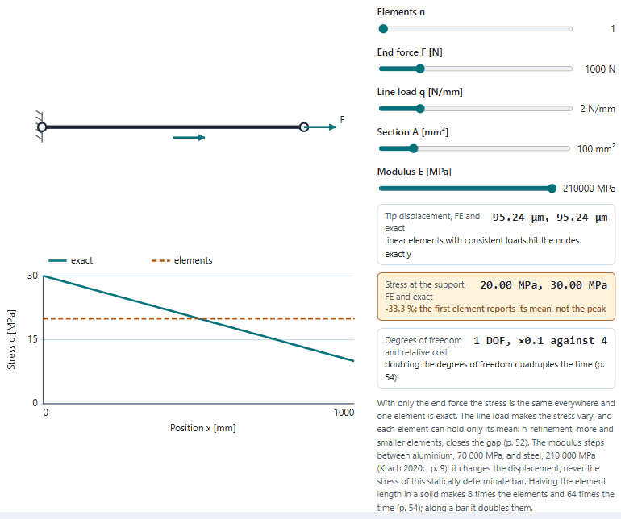
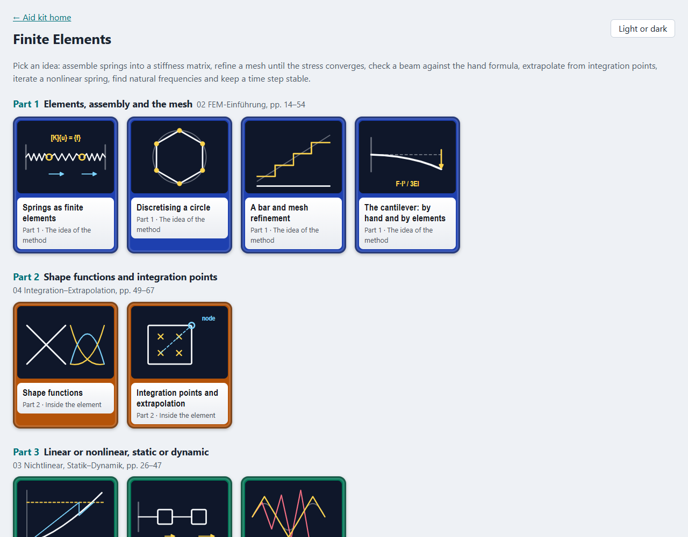
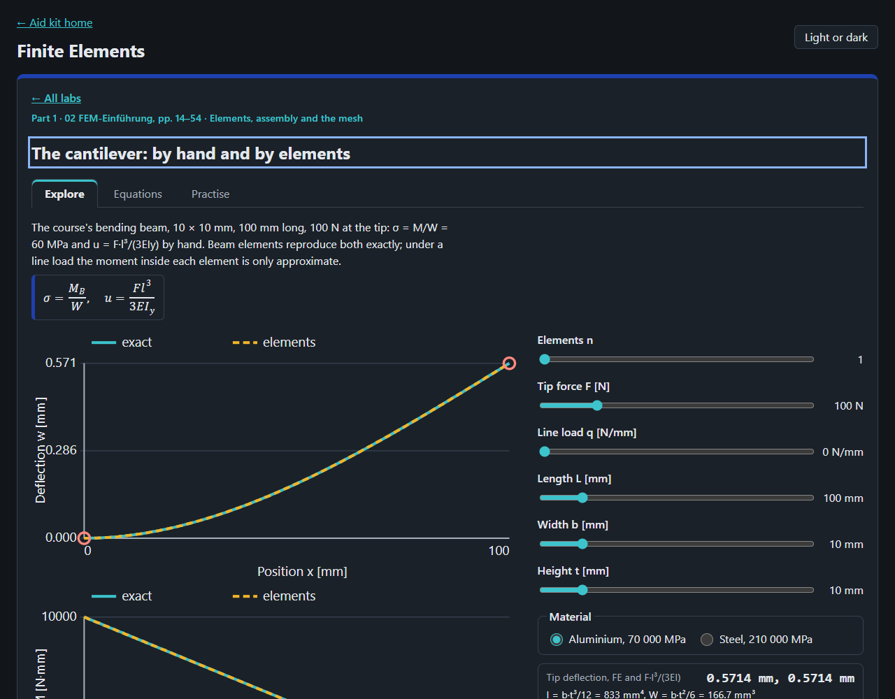

# Finite Elements

Nine ideas of the finite element method to play with in the browser, from springs assembled into a stiffness matrix
to a time step that blows up, after the slides of Krach (2018, 2020a, 2021), *CAE – Finite Elemente*, FH Technikum
Wien, 2nd semester, and the solved ModSim tasks of Puhwein (2020).

<picture>
  <source media="(prefers-color-scheme: dark)" srcset="docs/bar-dark.gif">
  
</picture>

## What is in it

| Part | Labs |
|---|---|
| 1 Elements, assembly and the mesh (02 FEM-Einführung) | springs as finite elements and [K]{u} = {f}, discretising a circle by chords, a bar under h-refinement and its cost, the cantilever by hand (σ = M/W = 60 MPa, F·l³/3EI) and by beam elements |
| 2 Shape functions and integration points (04) | linear and quadratic shape functions, Gauss-point values extrapolated to the nodes and averaged |
| 3 Linear or nonlinear, static or dynamic (03, ModSim) | a nonlinear spring under Newton's iteration, natural frequencies and mode shapes of a spring–mass chain, explicit against implicit time steps |

Each lab has a drawing or chart to move, readouts worked by the core, a table of its equations with slide set and
page, and practice questions. The slides print few numbers (σ = 60 MPa, 02 p. 40; 64 times the time, 02 p. 54; the
extrapolation sketch, 04 p. 62); those questions use them, the rest were worked by hand and say so.




## Where the lab and the course differ

- **The slides name a method, the lab computes it.** Newton–Raphson, the central difference and its limit Δt = 2/ω,
  the average-acceleration rule, the Gauss points at ±1/√3, the beam element's stiffness matrix and the quadratic
  shape functions are not printed in the slides; they are worked here by hand from their definitions, and each is
  checked against a second route in `tests/unit/core.test.js`.
- **Slips in the sources.** 04 p. 62 writes the von Mises stress as √(σx² + σy² + σz²), which is not the von Mises
  stress (it lacks the −σxσy … and shear terms); the lab does not use it. ModSim p. 28 calls the system stable when all
  Re(λ) < 0 right after defining λ = ω², the squared frequency of an undamped system, which is never negative: the
  criterion belongs to the eigenvalues of the state-space matrix, not to λ = ω².
- **Not here:** 2-D and 3-D elements, contact, plasticity beyond the capped field of the extrapolation lab, damping,
  fatigue (05) and the meshing practice of 07, which the slides teach by pictures.

## Open it

Locally, serve the repository's root and open `/fem-lab/`:

```bash
python -m http.server 8784 --bind 127.0.0.1
```

Tests: `node --test "tests/unit/*.test.js"` in this folder. The README pictures: `node scripts/record-readme.mjs`, with
the server running (see the script's head).

## Limits

Linear elastic springs, bars and Euler–Bernoulli beams in N, mm and MPa; point masses in kg and N/m; small dense
solvers, fine for the few dozen unknowns here. A learning aid; no text of the slides is reproduced, and equations are
cited by slide set and PDF page.
