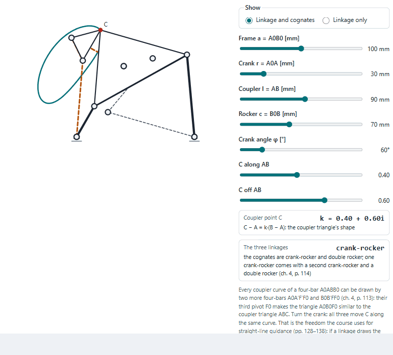
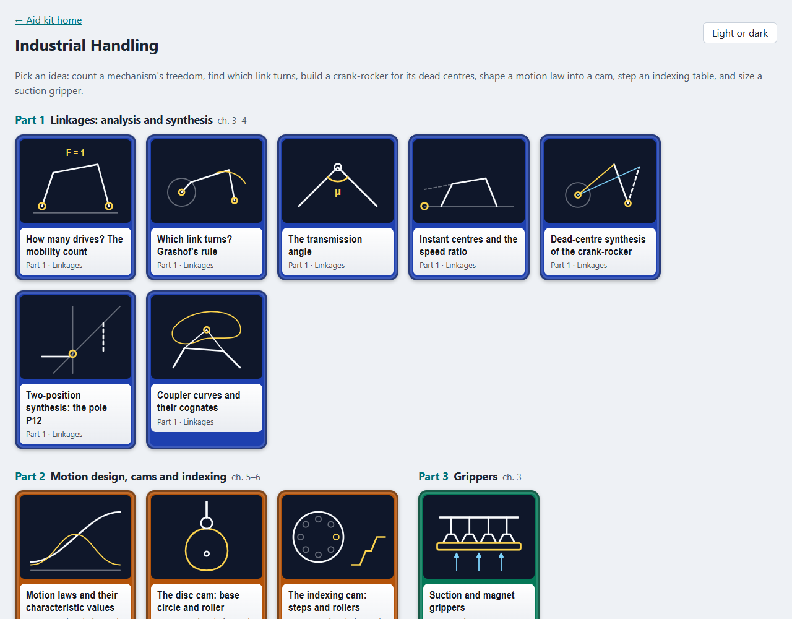
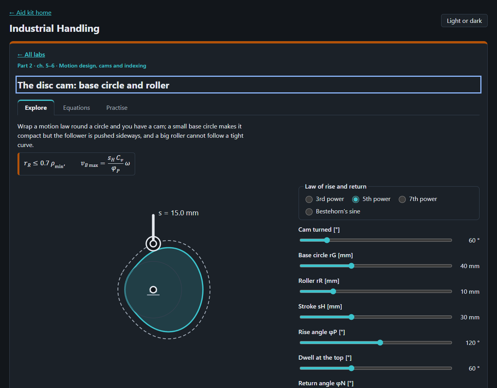

# Industrial Handling

Eleven ideas of industrial handling to play with in the browser, from counting a mechanism's freedom to sizing a suction
gripper, after the lecture notes of Berger (2021), *Industrial Handling* (IHA, Handhabungstechnik), FH Technikum Wien,
and its Übungsskript with the solved Übungen 5_1 to 5_3.

<picture>
  <source media="(prefers-color-scheme: dark)" srcset="docs/coupler-dark.gif">
  
</picture>

## What is in it

| Part | Labs |
|---|---|
| 1 Linkages: analysis and synthesis (ch. 3–4) | the mobility count, Grashof's rule, the transmission angle, instant centres and the speed ratio, dead-centre synthesis of the crank-rocker, two-position synthesis with the pole P12, coupler curves and their cognates |
| 2 Motion design, cams and indexing (ch. 5–6) | motion laws with Cv, Ca, Cj and CM and a 5th-order fit to any end values, the disc cam (base circle, roller, curvature), the indexing cam and the friction-wheel feed |
| 3 Grippers (ch. 3) | suction force against height and vacuum, the magnet gripper |

Each lab has a drawing or chart to move, readouts worked by the core, a table of its equations with chapter and page,
and practice questions. Where the course has printed results (ch. 3, p. 113; ch. 6, p. 19; the Übungen 5_1–5_3) the
questions use them; the rest were worked by hand and say so.




## Where the lab and the course differ

- **The course draws, the lab computes.** The transmission angle, the dead-centre synthesis, the speed ratio by the
  pole and the cam's pressure angle are worked from the course's definitions, and the lab says so beside each.
- **Two slips in the sources, corrected.** Übung 5_3 uses ω = 5.54 s⁻¹ for 50 rpm, where 2π·50/60 = 5.236 s⁻¹; its peaks
  are then 5.24 s⁻¹ and 104.7 s⁻², not 5.54 and 117.23. The magnet-gripper slide (ch. 3, p. 69) gives B in henry, the
  unit of inductance; flux density is in tesla.
- **Not in the course, so not here:** the Geneva wheel and the equations of vibratory feeders.

## Open it

Published at <https://abdulhamid-baghdadi.github.io/master-lectures-aid-kit/handling-lab/>. Locally, serve the
repository's root and open `/handling-lab/`:

```bash
python -m http.server 8772 --bind 127.0.0.1
```

Tests: `node --test "tests/unit/*.test.js"` in this folder. The README pictures: `node scripts/record-readme.mjs`, with
the server on port 8773 (see the script's head).

## Limits

Ideal rigid links and joints, no play, friction or mass except where a lab names them. A learning aid; no text of the
notes is reproduced, and equations are cited by chapter and PDF page.
