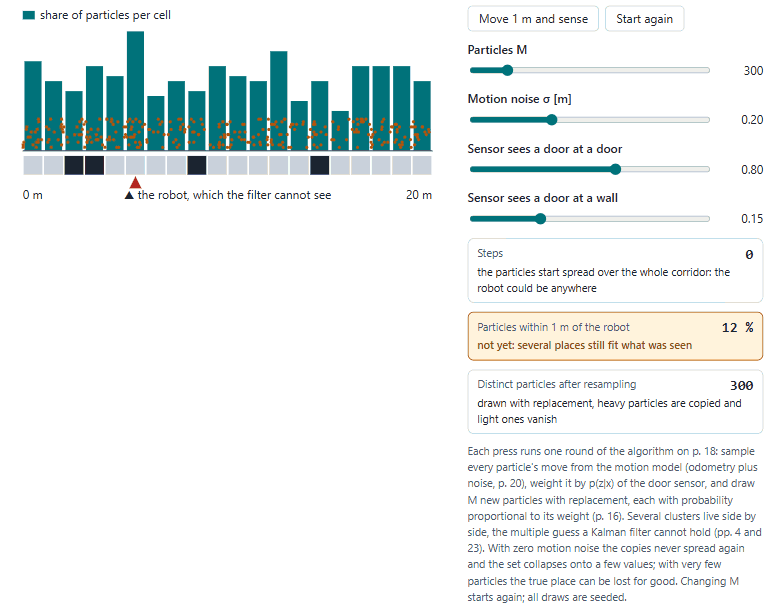
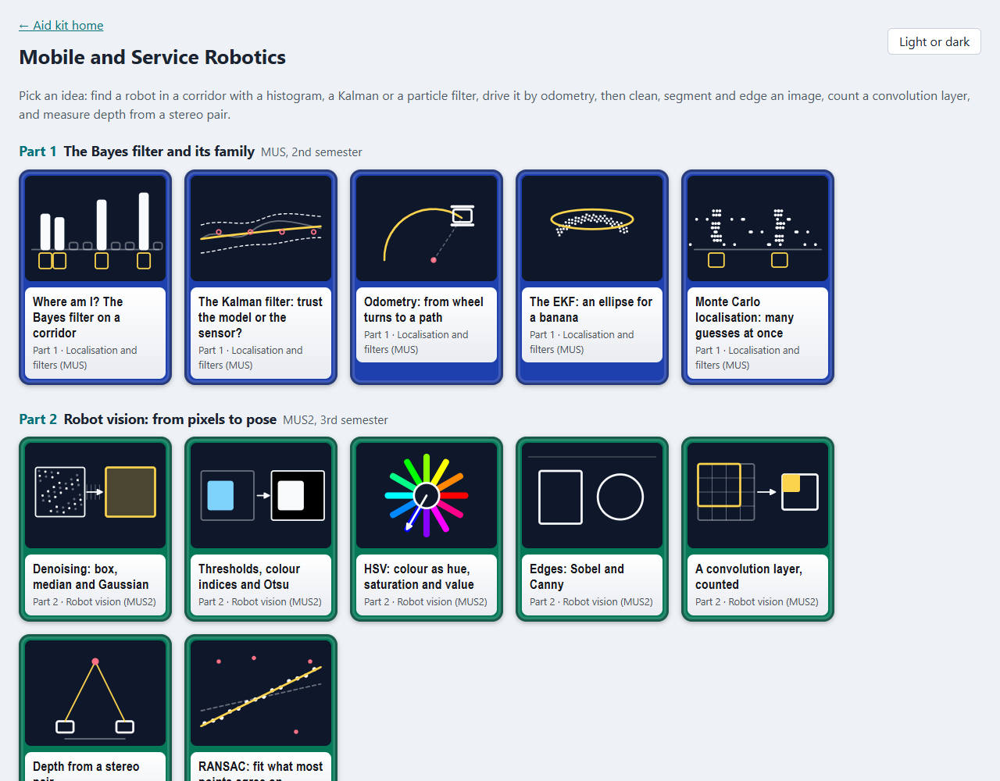
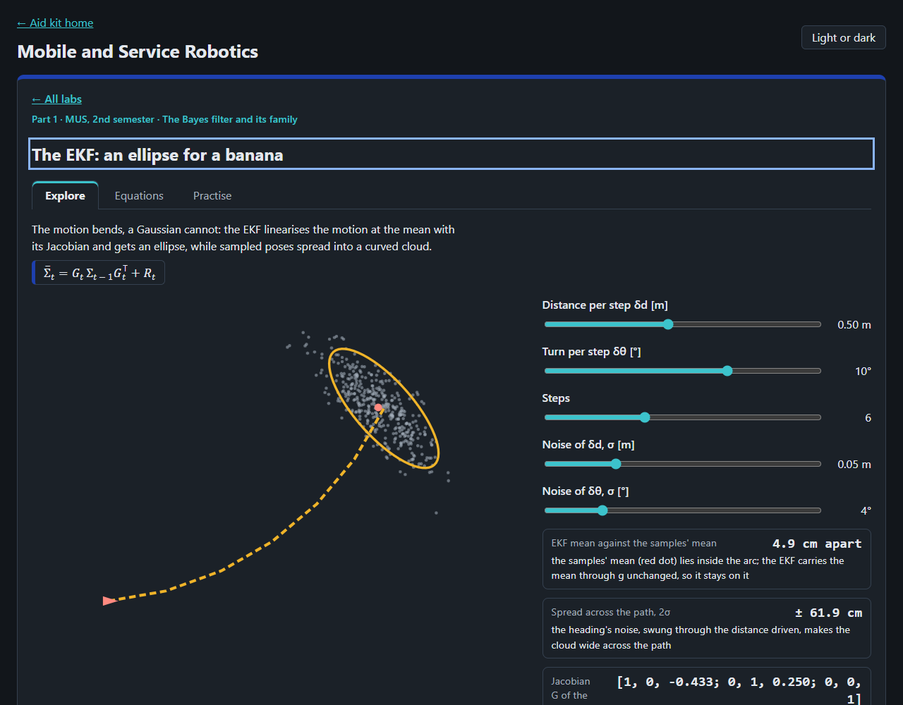

# Mobile and Service Robotics

Twelve ideas of mobile robots and robot vision to play with in the browser, from finding a robot in a corridor to
fitting a line through outliers, after the slides of Wöber (2018, 2019, 2019a, 2020, 2021) and Thalhammer (2021) for
*Mobile- und Servicerobotik* 1 and 2 (MUS and MUS2), FH Technikum Wien.

<picture>
  <source media="(prefers-color-scheme: dark)" srcset="docs/particles-dark.gif">
  
</picture>

## What is in it

| Part | Labs |
|---|---|
| 1 The Bayes filter and its family (MUS, 2nd semester) | the histogram filter on a corridor with a door sensor, the Kalman filter in one dimension, odometry of a differential drive with its centre of rotation, the EKF's ellipse against sampled poses, Monte Carlo localisation |
| 2 Robot vision (MUS2, 3rd semester) | box, median and Gaussian denoising, thresholds with the excess colour index and Otsu's criterion, RGB and HSV with a hue mask, Sobel and Canny edges, a convolution layer counted against the slides' network summary, stereo depth and the pinhole camera, RANSAC against least squares |

Each lab has a drawing, image or chart to move, readouts worked by the core, a table of its equations with file and
PDF page, and practice questions. The slides print no worked numbers except the network summary of the CNN slides
(p. 10), whose counts are used; the other answers were worked by hand and say so. Every image is a synthetic example
scene, and all noise comes from a seeded generator, so a lab looks the same on every visit.




## Where the lab and the slides differ

- **Four slips in the sources, corrected.** HSV to RGB (Segmentation, p. 31, eq. 19) prints (q, V, t) for h = 2;
  it must be (p, V, t), or a green turning cyan comes back with red at full strength (a test shows both). The dense
  layer's weight count (CNN, p. 7) is printed nL−1·nL + 1; with one bias per node it is (nL−1 + 1)·nL, which the
  slide's own convolution count gives for a 1 × 1 kernel. The gradient's direction (Edges, p. 7, eq. 3) is printed
  atan2(fx, fy); the lab measures it from the x axis, atan2(fy, fx). The Kalman prediction's mean is written
  Axt−1 − But in a bullet of Gaussianfilters, p. 6; the equation beneath it and the algorithm have +.
- **Worked here, not on the slides,** and marked so in each equations table: the Jacobian of the odometry step, the
  process noise from the noise of δd and δθ, the turning radius and the output size of a convolution.
- **Otsu's threshold** follows the slide's criterion J = (μ1 − μ2)²/(σ1² + σ2²) (Segmentation, p. 14) and skips
  classes holding under 2 % of the pixels.
- **Not in the labs yet:** graphical models, SLAM, EKF localisation with landmarks, and MUS2's Hough lines and
  circles, contours, image features, classification and PCA.

## Open it

Locally, serve the repository's root and open `/mobile-robots-lab/`:

```bash
python -m http.server 8782 --bind 127.0.0.1
```

Tests: `node --test "tests/unit/*.test.js"` in this folder. The README pictures: `node scripts/record-readme.mjs`, with
the server on port 8782 (see the script's head).

## Limits

Ideal sensors and wheels except for the noise each lab names; small synthetic images in place of camera pictures. A
learning aid; no text of the slides is reproduced, and equations are cited by file and PDF page.
