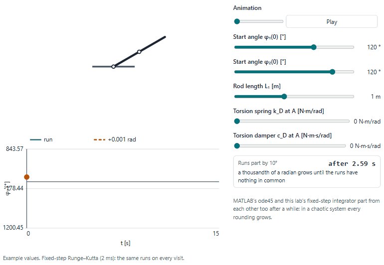
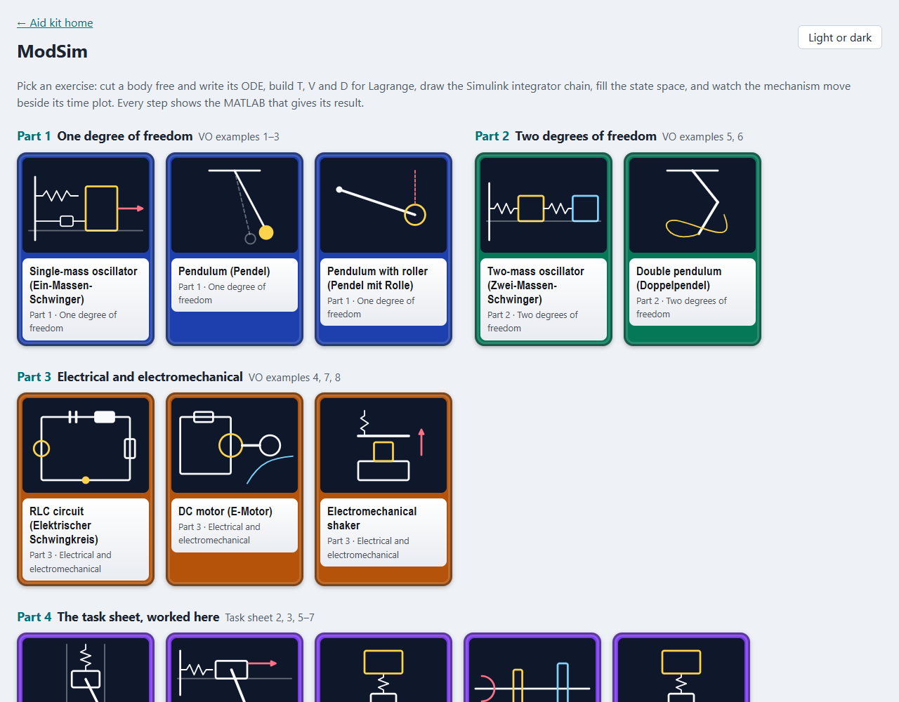
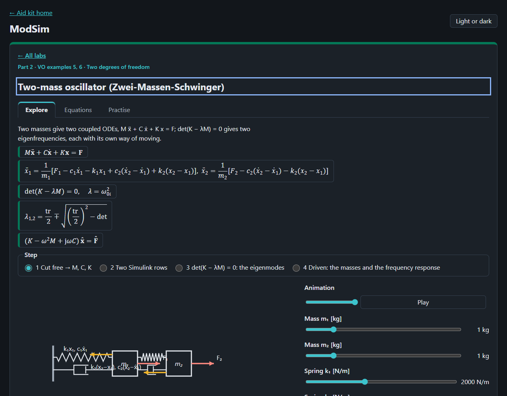

# ModSim

The exercises of Modellbildung und Simulation (ModSim, FH Technikum Wien, 2nd semester, summer term 2021) animated
step by step: the eight worked lecture examples of Puhwein (2021a) and the 13 tasks of the task sheet Puhwein (2021b).
Every step of every exercise is a view of its own (a free-body diagram whose forces arrive, T, V and D built term by
term, the ODE drawn as the Simulink integrator chain, the state space filling in, the mechanism moving beside its time
plot), and every view shows the MATLAB that gives its result, written from the view's current values.

<picture>
  <source media="(prefers-color-scheme: dark)" srcset="docs/doppel-dark.gif">
  
</picture>

## What is in it

| Part | Labs (exercises) |
|---|---|
| 1 One degree of freedom | the single-mass oscillator: forces → ODE → Simulink → state space → the mass bouncing (VO 1); the pendulum: T, V, D term by term, nonlinear against linear, rest angles and their stability from the Jacobian, Simulink and state space (VO 2); the pendulum with roller: S(φ₁) from the geometry, K of rod and rolling disc, the lab's equation beside the sheet's, the Simulink model of p. 24 (VO 3) |
| 2 Two degrees of freedom | the two-mass oscillator: M, C, K, two Simulink rows, det(K − λM) = 0 and the trace, the eigenmodes moving, the driven masses beside the frequency response (VO 5, with the TM3 note's values); the double pendulum: K and V term by term, chaos from 0.001 rad, the energy it keeps, the linear eigenmodes (VO 6) |
| 3 Electrical and electromechanical | the RLC circuit with its energy between coil and capacitor (VO 4); the DC motor's two equations, two Simulink rows, 3 × 3 state space, run-up and power flow (VO 7); the shaker's transfer functions, state space and the current with and without back-EMF (VO 8) |
| 4 The task sheet, worked here | all 13 tasks: 1 (elastic pendulum), 2 (pendulum on a sprung block, the group's task, with their values) and 3 (on the floor), 4 (unbalance), 5 (quarter car), 6 (torsional oscillator), 7 (hanging chain), 8 (coupled pendulums), 9–10 (rolling discs), 11–12 (roller pendulum), 13 (robot manipulator): no solution sheet; worked here |

Each lab has steps to pick, a player that runs each step's animation once (or a slider that steps it, when the reader
asks for reduced motion), readouts, the source's result beside the lab's own, and a MATLAB panel with a copy button:
the Lagrange recipe with `syms` and `diff` as the group wrote it, `ode45` with `f = @(t,x) [...]`, `ss`, `eig`,
`eig(K,M)`, `bode`, `tf`, `jacobian`, and the Simulink and Simscape block chain in words. Its Equations tab cites the
lecture by PDF page; its Practise tab asks the exercise's questions.




## Source notes

The lecture examples give symbols and no numbers (only the Simulink Fcn blocks carry amplitudes), so the labs start
from example values, labelled; the two-mass lab uses the TM3 note's values and reproduces its λ = 500 and 3000 s⁻²,
f₀ = 3.5588 and 8.7173 Hz. Every result the lecture prints was checked against a re-derivation; they agree except where
listed here. Transcriptions with every page: `docs/sources/vo-solutions-a.md`, `vo-solutions-b.md`.

- **VO p. 7 (example 1):** says the damping is neglected, yet keeps c(ẋ − ẋ₀). The Simulink model of p. 9 calls the
  damper's gain b, the text c. The state space of p. 8 drops x₀, ẋ₀ silently and gives no C, D.
- **VO p. 12 (example 2):** V_G = −m g L₁ sin φ₁ belongs to an angle from the horizontal; for φ from the vertical it is
  m g L₁(1 − cos φ). The printed ∂L/∂φ₁ is not the derivative of the printed L; the final equation (p. 13) is right.
- **VO p. 13:** the scalar state equation has + g/L and + k_D/(mL²) where the matrix beside it has −; B = [0; 1/(mL²)]
  has the opposite sign to −M₁ in the ODE. The rest angles nπ ignore the torsion spring: with k_D > 0, π is not one.
- **VO p. 18:** the saddle at (2n+1)π lies in the third quadrant of the tr–det chart (tr < 0, det < 0), not the first.
  δ² < 4ω² is an assumption (light damping), not a fact. The Simulink model is θ̈ = sin 2πt − (g/L) sin θ, without the
  1/(mL²), k_D and c_D of the derived equation. p. 10 writes M_c = c_D Δẋ for Δφ̇.
- **VO pp. 20–24 (example 3):** L₁ = 0.5 and L₂ = 0.25 are substituted without being given. The inertia term is printed
  (3/2)m₂·r (kg·m); from K on p. 22 it is (3/2)m₂L₁². The spring's moment lacks the lever L₁: the sheet's
  (2 sin φ₁ + cos φ₁)/(4S) is twice dS/dφ₁ (tested). p. 23 has m₂r²/3 for p. 22's m₂r²/2. The Simulink model of p. 24
  carries the same gain and draws the L0 sum as + +. The lab runs both equations side by side.
- **VO p. 26 (example 4):** u_C = x₁, then (1/C)·x₁: right only if x₁ is the charge q, as the lab takes it.
- **VO pp. 28–30 (example 5):** "stable if all Re(λ) < 0" with λ = ω² > 0 mixes the eigenproblem with the state matrix;
  the 2 × 2 "Jacobi matrix" of p. 29 is M⁻¹K, the negative of ∂f/∂x (p. 30 is right); det(A) > 0 and tr(A) < 0 settle
  stability only for 2 × 2 matrices.
- **VO pp. 33–40 (example 6):** ÿ_S2 lacks a minus sign (p. 33); cos(φ₂ − φ₁) is expanded with − for + (p. 34); the
  stiffness reads 3gmL₁² and gmL₁² for 3gmL₁ and gmL₁ (pp. 34, 35, 39); L carries +½k_D(φ₂ − φ₁)² for − (p. 37); ∂L/∂φ₂
  has sin φ₁ for sin φ₂ (p. 38), and k_D, c_D are not scaled by 2/(mL₁²) as the other terms are; the stable rest is left
  empty (p. 40); the Simulink model of p. 40 is the point-mass double pendulum, not the rods derived. The equations of
  p. 33 without spring and damper are right; the lab's energy test confirms them.
- **VO p. 42 (example 7):** the Simulink model adds a load torque of 10 the ODE does not have; the lab names it M_L.
- **VO p. 44 (example 8):** the transfer function with s² is labelled G_Ux; it is G_Ua. The back-EMF is left out (as the
  text says); the lab shows the coupled current too, which, like the sheet's Simscape plot (p. 45), dips and comes
  later to the same end value.
- **TM3 note p. 1:** f0 = om/6.28 instead of om/(2*pi), 0.05 % off.

The student group's work (task 2, `docs/sources/student-work.md`) was the model for the MATLAB style, not for its
results:

- **`Jacobian.mlx`:** ÿ has `y_dot^2` where θ̇² belongs and the sign of that term flipped, so the report's Jacobian
  (eq. 58) is wrong in its y row; the two accelerations, each containing the other, are never solved together, so
  `jacobian` misses the coupling.
- **`Mechanical_Equations.mlx`:** the θ part of V has the wrong sign (the hanging rest would be unstable); the Drallsatz
  has `m_1*g*sin(theta)` without its lever l₁/2; `O_y` is used for `A_y`; `isolate(eq_6, …)` should be eq_7, so the
  Newton-equals-Lagrange check cannot hold; `I_1` stands for two inertias.
- **Report:** T's coupling term has the wrong sign (eq. 25–26; the final equations are right); the linearisation keeps
  θ̈·θ and ÿ·θ and is taken at y = 0 instead of y* = m_ges g/k (pp. 8–9); the mass matrix is not symmetric (p. 11); the
  design values give a pendulum at 1.6 Hz, outside the 3–10 Hz asked (p. 19); p. 15 cites Abb. 12 for Abb. 7.
- **`simscape_variables.m`:** `ylabel('phi [m]')` for rad; titles say M_2 for M_1; `tout`, `simout` used before any run.

## The task sheet's figures: the readings taken

All 13 tasks are in. The sheet gives a figure per task and nothing else (`docs/sources/task-sheet.md`), so every number
in tasks 1, 4 and 8–13 is an example value, labelled "example value — not given on the sheet" on each slider. Where the
figure leaves a choice, the lab takes one reading and says so on its first step (added 10 Nov 2026). Each was then
checked against the sheet's own figure (PDF page images, 150 and 400 dpi) on 10 Nov 2026. The sheet draws no
coordinate, so the positive senses are the lab's; its moments are drawn clockwise (tasks 1, 8, 13 opposite to the
lab's φ, a sign that is only a phase shift of π in φ₁; tasks 9–12 the sense that rolls the disc to the right, as the
lab takes it).

- **Tasks 2, 3 (pendulum on a sprung block):** 2, y (down) or x (right) and θ from the downward vertical; block m₂
  guided, spring k ∥ damper c to the ceiling (task 2) or the wall (task 3); rod m₁, l₁ pinned at the block's centre with
  end mass m₃; torsion spring k_T ∥ damper c_T and M₁ at the pin, F₁ on the block. Task 2 keeps the group's values
  (their report's Tab. 1). Checked against the figure (PDF p. 1 for task 2, p. 2 for task 3) on 10 Nov 2026: agrees;
  F₁ is drawn down (task 2) and to the right (task 3), as the lab's y and x; M₁ is drawn clockwise, against the lab's θ
  (a phase shift of π only). The grey symbol at the pin is read as k_T ∥ c_T, as at the other pivots.
- **Tasks 5, 7 (path-excited chains):** 2, x₁ and x₂ from the static rest; w(t) moves the free end of spring 1 and
  damper 1, from below (task 5, road under the wheel m₁) or above (task 7, the suspension point), no other force.
  Checked against the figure (PDF p. 3 for task 5, p. 4 for task 7) on 10 Nov 2026: agrees.
- **Task 6 (torsional oscillator):** 2, φ₁ and φ₂; the shaft's end turned by w(t), and, as drawn, M₁(t) = M₀₁ cos Ω₁t
  on J₁ and M₂(t) = M₀₂ cos Ω₂t on J₂, each at its own frequency (phases φ₁, φ₂ taken 0). Checked against the figure
  (PDF p. 3) on 10 Nov 2026: changed. The lab had w(t) alone; M₁, M₂ are now in the model (`torsion2`), the sliders and
  the MATLAB and Python, held by `tasks.test.js` ("task 6: M₁ … on J₁ and M₂ … on J₂"). The transmissibility stays that
  of w(t) alone. M₀₁, M₀₂, Ω₁, Ω₂ are example values — not given on the sheet.
- **Task 1 (elastic pendulum):** 2 degrees of freedom, r and φ: the block looks rigidly fixed to the rod's end, so it
  turns with it (J₁ of a 0.10 m × 0.06 m block). The other reading, the block hinged at its centre, is a slider: its own
  turn is then undriven and J₁ leaves φ's equation. Checked against the figure (PDF p. 1) on 10 Nov 2026: agrees (block
  drawn rigid on the rod, grey rotary spring-damper at the pivot); nothing changed.
- **Task 4 (unbalance):** 2, y₁ and y₂: Ω(t) is read as a prescribed constant speed (drawn blue like the path
  excitations), so the rod angle β = Ωt is given and the unbalance acts as −(m₃/2 + m₄)l₃Ω² cos Ωt on m₁. Read as a
  torque, β would be a third coordinate. Energy is not kept even undamped; the test checks it against the drive's work. Checked against the figure (PDF p. 2) on 10 Nov 2026:
  agrees (rod m₃, l₃ pinned at m₁'s centre, m₄ at its end, Ω(t) blue); whether Ω(t) is a speed stays the sheet's open
  point.
- **Task 8 (coupled pendulums):** 2, φ₁ and φ₂; each rod read as two segments mᵢ, lᵢ (the double label), so a rod is
  2mᵢ, 2lᵢ and the spring holds at lᵢ; pivots b apart with the spring unstretched at rest; its length kept exact. Checked against the figure (PDF p. 4) on 10 Nov
  2026: agrees (spring–damper between the two labels of each rod, grey rotary spring-dampers at both pivots, M̂₀₁, M̂₀₂);
  b stays an example value.
- **Tasks 9, 10 (rolling discs):** 2, x₁ and x₂; solid discs (J = ½mr²) rolling without slip; task 10's wall spring
  at the top of the rim stretches by 2x₁ (first order), the disc-to-disc spring taken at the axles. Checked against the
  figure (PDF p. 5) on 10 Nov 2026: agrees; the disc-to-disc spring in task 10 is now confirmed at the axles (a bar runs
  from each axle to its end plate), so its step no longer calls it unclear.
- **Tasks 11, 12 (roller pendulum):** 2, x and φ; massless rod with a point bob; M₁ turns the disc against the floor
  (the sheet does not say whether it acts between disc and rod); task 11's spring at the top of the rim (2x), task 12's
  at axle height (x). The model is task 3's with a rolling disc for the block. Checked against the figure (PDF p. 6) on
  10 Nov 2026: agrees; task 12's spring is now confirmed at the axle (a bar runs through the end plate to it). Still
  open: where M₁ acts, and the rod (unlabelled) and bob m₂ (drawn as a disc, taken as a point).
- **Task 13 (robot manipulator):** 2, absolute link angles; uniform links, elbow motor m₃ and load m₄ as points; the
  motor torques are inputs, the elbow's acting back on link 1 (Q = (M₁ − M₂, M₂)). The core is the double pendulum's:
  VO example 6 is this model with equal rods and no point masses, and now calls it. Checked against the figure (PDF p. 7)
  on 10 Nov 2026: agrees (M₁ at the base, M₂ at the elbow, grey rotary spring-dampers at both joints).

Held by `tests/unit/tasks.test.js` (energy kept undamped; eigenfrequencies against closed forms derived by hand, among
them ω₁ = √(g/L), ω₂ = √(g/L + 2ka²/(mL²)) for point-mass coupled pendulums and λ = (g/l)(2 ∓ √2) for the arm) and
`python-run.test.js` (sympy's Lagrange equations from each T, V, D at a test state).

## MATLAB facts the code relies on

Read on the MathWorks reference pages on 7 Nov 2026 (bibliography.json, MathWorks 2026): `diff(L, diff(x(t),t))`
differentiates by a derivative (the diff page's own Euler–Lagrange example); `odeToVectorField` orders the states
Y[1] = x, Y[2] = ẋ and returns the order as S, then `matlabFunction(V,'vars',{'t','Y'})` gives ode45's handle;
`ode45(odefun,tspan,y0)` wants a column from odefun(t,y) and returns one row per time; `eig(K,M)` solves K·V = M·V·D,
so D holds λ = ω²; `bode` returns the magnitude as a ratio, 1×1×N; `jacobian(f,v)` puts ∂fᵢ/∂vⱼ at (i, j); the Sum
block takes one sign per input, the Integrator's initial condition defaults to 0. The pages were read and summarised by
a helper agent and not re-read word for word. **MATLAB is not installed here**: the snippets are checked for names used
before they are assigned (every view of every lab, tests/unit/matlab-defined.test.js), and most run in GNU Octave (next
section but one).

## Python beside the MATLAB

Every view also shows the same steps in Python, beside the MATLAB, and the Python panels run without a MATLAB licence
(Python 3 with numpy, scipy, sympy, matplotlib and python-control 0.10.2): sympy for the Lagrange recipe (`symbols`,
`Function`, `diff`, `solve`), `solve_ivp(f, t_span, x0)` with `f = lambda t, x: [...]` for ode45's `@(t,x) [...]`,
`scipy.linalg.eig(K, M)` for `eig(K,M)`, python-control for `ss`, `step`, `tf` and the frequency response.
`tests/unit/python-run.test.js` runs 65 of the 71 snippets and compares what they print with the lab: the
accelerations of the Lagrange equations at a test state, eigenfrequencies, poles, matrices, and solve_ivp's end state.
What Python cannot do: **Simulink and Simscape have no Python counterpart**, so those views give the parameters and
the blocks as comments and point to the ODE the motion view integrates; they and the chaotic double pendulum, which
only plots, are checked for undefined names only. Differences the snippets state (scipy and sympy pages, 7 Nov 2026):
`solve_ivp` defaults to RK45 with rtol 1e-3 and atol 1e-6 (ode45's RelTol and AbsTol defaults) and returns one row per
state where ode45 returns one row per time; `scipy.linalg.eig` returns complex eigenvalues in no promised order, so
they are sorted; sympy has no `odeToVectorField`, so `solve` gives the accelerations; MATLAB's `\` is
`np.linalg.solve`.

## Running the MATLAB in Octave

The MATLAB panels also run in GNU Octave, which is free (checked with Octave 11.3.0, its control 4.2.1, signal 1.4.7
and symbolic 3.2.2 packages: `pkg load control signal symbolic`). `tests/unit/matlab-run.test.js` runs every view's
MATLAB there, headless, and 49 of 71 give the lab's own accelerations, eigenfrequencies, poles, matrices and end states;
the chaotic double pendulum only plots and is held to running. ode45's end states are held to 5 % of the largest value
of the lab's run, as the Python's are: Octave's ode45 is the same Dormand–Prince pair with the same default
tolerances, but chooses its steps otherwise. Twenty-two need real MATLAB, and their MATLAB is not changed to suit Octave
(10 Nov 2026):

- Simulink and Simscape are not in Octave: steps 2 of the one-mass, two-mass, RLC and motor labs, step 4 of the
  roller lab.
- `diff(Lag, q)` of a symbolic function `q(t)` stops Octave's symbolic package with "max_recursion_depth exceeded"
  (`diff(Lag, q(t))` works there). MATLAB takes it: the diff page's Euler–Lagrange example does the same. Step 1 of
  the one-mass, pendulum and double pendulum labs and of tasks 1–4 and 8–13, step 2 of the roller lab: 14 views.
- `odeToVectorField` is not in Octave's symbolic package: step 1 of the RLC, motor and shaker labs.

Tasks 5–7's equations of motion are written directly, without `diff` by a function, and run: their accelerations at
the Python's test state are checked. No MATLAB snippet was found wrong.

## Open it

Serve the repository's root and open `/modsim-lab/`:

```bash
python -m http.server 8772 --bind 127.0.0.1
```

Tests: `node --test "tests/unit/*.test.js"` in this folder. The README pictures: `node scripts/record-readme.mjs`, with
the server on port 8772 (see the script's head).

## Limits

Fixed-step Runge–Kutta (deterministic, the same on every visit); MATLAB's ode45 picks its own steps, so chaotic runs
part from it after a while. Most values are example values, labelled. The task-sheet labs have no solution sheet and
are worked here. The Simulink and Simscape models are described in words, not built: no .slx file was opened. A
learning aid; no text of the course is reproduced.
