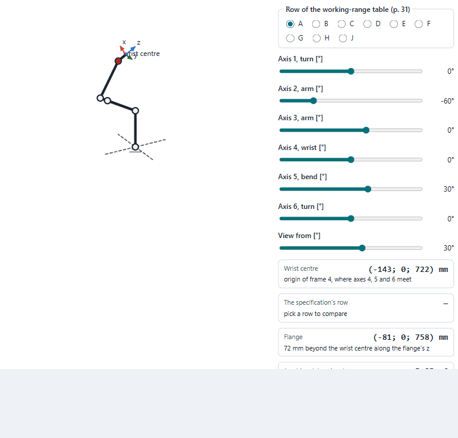
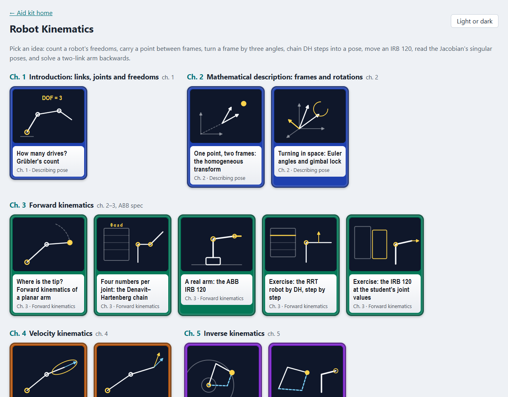
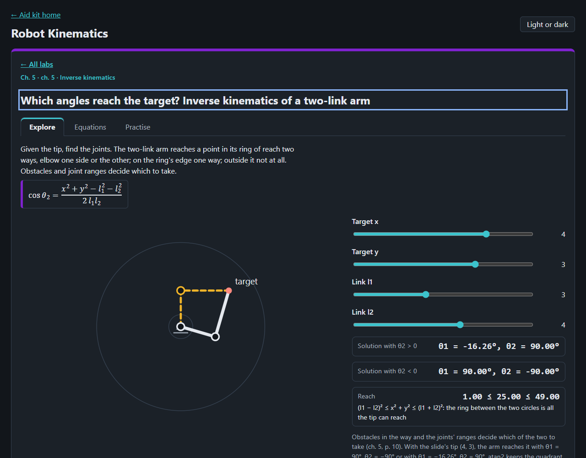

# Robot Kinematics

Eight ideas of robot kinematics to play with in the browser, and four exercises solved step by step, from counting a robot's freedoms to solving a two-link arm
backwards, after the lecture slides of Ajanović (2020), *Industrierobotik* (IRB), FH Technikum Wien, based on slides by
M. Aburaia, and the product specification of the ABB IRB 120 (ABB 2020).

<picture>
  <source media="(prefers-color-scheme: dark)" srcset="docs/irb120-dark.gif">
  
</picture>

## What is in it

| Chapter | Labs |
|---|---|
| 1 Introduction (ch. 1) | Grübler's count of degrees of freedom |
| 2 Frames and rotations (ch. 2) | a point in two plane frames and the homogeneous transform; Euler, Cardan and roll-pitch-yaw angles with gimbal lock |
| 3 Forward kinematics (ch. 2–3, ABB) | the planar two-link arm and the bent arm; the Denavit–Hartenberg chain of the slides' RRT robot; the IRB 120 as a DH chain |
| 4 Velocity kinematics (ch. 4) | the Jacobian of the two-link arm, its speed ellipse and its singular poses |
| 5 Inverse kinematics (ch. 5) | both solutions of the two-link arm and its ring of reach |

Four exercises are solved step by step, each step animated and shown with the Python (numpy, in the style of the
student's own `forward_kinematics(spyder).py`) and the MATLAB (Robotics System Toolbox) that give its result, written
from the sliders' values: the RRT robot by DH (ch. 3, pp. 22–26), the IRB 120 at the student's joint values (his
script, ABB p. 31), the Jacobian column by column and towards its singularity (ch. 4, pp. 15, 20), and inverse
kinematics with both elbows (ch. 5, p. 20), a three-link arm's wrist and the IRB 120's wrist split.

Each lab has a drawing to move, readouts worked by the core, a table of its equations with chapter and PDF page, and
practice questions. Where the slides or the specification print a result the questions use it; the rest were worked by
hand and say so.




## Where the lab and the sources differ

- **The IRB 120's DH table is built here.** Neither the slides nor the specification give one. The lab builds it from the
  dimensions on p. 12 (290, 270, 70, 302 and 72 mm) and checks it against the wrist-centre table on p. 31: seven of the
  nine rows agree within 1 mm.
- **Rows D and H of that table (ABB 2020, p. 31) print Z = 270 mm.** With axis 2 at ±90° and axis 3 at −77° the upper
  arm lies level at the shoulder, 290 mm up (p. 12), and the forearm, turned 77° to cancel its 13° step
  (tan⁻¹(70/302)), lies level too, so the wrist centre is at 290 mm. The same geometry gives rows A, B, C, E, F, G and J
  as printed. Likely a misprint; the lab says so where the row is picked.
- **Ch. 2, p. 61 says z(45°)x′(30°)z″(−45°) equals z(0°)x′(30°)z″(0°).** It does not: the first turns 30° about an axis
  at 45° in the xy-plane, the second about x, and the two differ by 22.74° (by quaternions: cos(θ/2) = cos²15° +
  sin²15° cos 45°). A true second set for the first is (225°, −30°, 135°). Checked in `tests/unit/core.test.js`.
- **Ch. 5, p. 8, the ZX′Z″ table:** rows 3–5 give the target matrix; rows 1 and 2 (θ2 = 270°) give sin θ2 cos θ3 = 0
  where the target needs 1, so they are not solutions. The slide picks row 3, which is right.
- **The slides cut numbers after three decimals** instead of rounding: ch. 2, p. 38 prints 4.693 for 4.6937, 0.104 for
  cos 84° = 0.10453 and 0.994 for sin 84° = 0.99452.

## Source notes for the stepped exercises (7 Nov 2026)

- **The student's DH table agrees with this lab's.** His seven rows (report slide 4; script) split the base's 290 mm
  into 165 + 125 mm by a fixed first row; at any axes both give the same flange, and at home both give his printed
  T = [0 0 1 374; 0 −1 0 0; 1 0 0 630] (notebook cell 1) and ABB p. 31 row A's wrist centre (302, 630) mm.
- **The student's script is sympy, not numpy;** the panels use numpy with his matrix and names (m0_1, …). No numeric
  slip found in it. His report's table (slide 4) lists θ3 = −90° in the script but leaves that cell blank on the slide.
- **Ch. 5, p. 20 writes θ1 = atan2(y, x) ± atan2(l2 sin θ2, …)** with θ2 = ±41.05°: the minus goes with +41.05°
  (26.52°), the plus with −41.05° (62.80°); the slide's "44.66 ± 18.14" leaves the pairing to the reader.
- **Ch. 4, p. 19, the RT robot:** the slide's second column is ⁰R₁(0, 0, 1)ᵀ written with ⁰R₁ for the sliding joint 2,
  as the schema of p. 15 says (⁰R_{i−1}); its result (cθ1, sθ1, 0) agrees with this lab's.
- **det J = l1 l2 sin θ2 is not printed** in ch. 4; it is worked here from p. 20's matrix.
- **The slides solve no three-link arm and no wrist split with numbers** (ch. 5, p. 4 shows the RRR arm, p. 6 the
  central wrist's eight configurations). Both are worked here and held by round trips; for the IRB 120 the elbow with
  the forearm above is the one inside the axis ranges of p. 32 in the tested poses.
- **MATLAB:** setFixedTransform with 'dh' ignores θ of a revolute joint, so axis 2's −90° offset is added to q; the
  panels say so. geometricJacobian puts the angular rows first, so the position rows are J(4:5,:).
- **The chain agrees with the URDF, axes 4–6 included.** The student's project's `irb120_support/urdf/irb120_2.urdf`
  (joints at lines 209–254, flange 72 mm at line 258) composed joint by joint gives the lab's flange pose at 50 seeded
  poses within 0.01 mm, with the URDF's angle equal to the lab's axis angle (no offset or sign change); its limits are
  ABB p. 32's ranges, axis 6 at ±400°. The specification's axes figure (p. 10) shows each axis's + and − sense only as
  arrows. Checked in `tests/unit/urdf.test.js`; nothing in the core had to change.

## Open it

Not published. Locally, serve the repository's root and open `/robotics-lab/`:

```bash
python -m http.server 8781 --bind 127.0.0.1
```

Tests: `node --test "tests/unit/*.test.js"` in this folder. The README pictures: `node scripts/record-readme.mjs`, with
the server on port 8781 (see the script's head).

## Limits

Ideal rigid links and joints, no play, no masses. The IRB 120's axes 4–6 are checked against the ROS-Industrial URDF,
not against a real robot's controller. A learning aid; no text of the slides is reproduced, and equations are cited by chapter
and PDF page.
