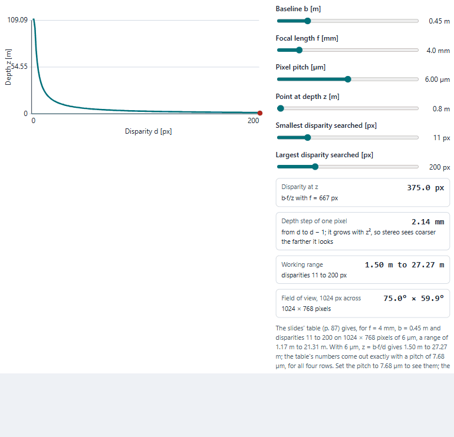
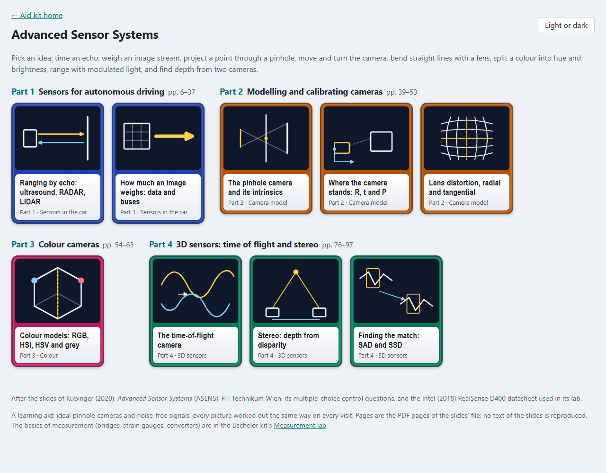
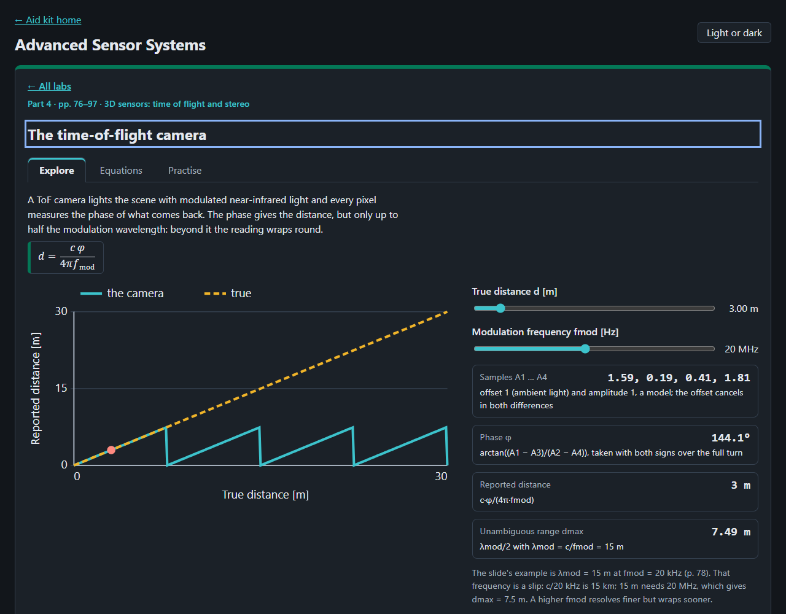

# Advanced Sensor Systems

Nine ideas of the sensors of an autonomous car to play with in the browser, from timing an echo to finding depth with
two cameras, after the slides of Kubinger (2020), *Advanced Sensor Systems* (ASENS), FH Technikum Wien, its
multiple-choice control questions (Kubinger 2018) and the Intel (2018) RealSense D400 datasheet used in its lab.

<picture>
  <source media="(prefers-color-scheme: dark)" srcset="docs/stereo-dark.gif">
  
</picture>

## What is in it

| Part | Labs |
|---|---|
| 1 Sensors for autonomous driving (pp. 6–37) | ranging by echo with sound and light (ultrasound, RADAR, LIDAR), the data rate of an image stream |
| 2 Modelling and calibrating cameras (pp. 39–53) | the pinhole and the intrinsics fx, fy, cx, cy; the extrinsics R, t and the projection matrix P; radial and tangential lens distortion |
| 3 Colour cameras (pp. 54–65) | RGB to HSI, HSV and grey, and the Bayer pattern back to RGB |
| 4 3D sensors (pp. 76–97) | the time-of-flight camera and its wrap-round; stereo depth from disparity, its resolution and the invalid depth band; the correspondence search by SAD and SSD |

Each lab has a drawing or chart to move, readouts worked by the core, a table of its equations with PDF page and slide,
and practice questions. The slides' printed numbers are used where they exist (p. 35, p. 78, p. 87); the past exams ask
only for explanations and sketches, so the rest were worked by hand and say so.




## Where the lab and the slides differ

- **Two slips in the slides, checked.** The ToF example (p. 78) gives λmod = 15 m at fmod = 20 kHz; c/20 kHz is 15 km,
  so it must be 20 MHz. The stereo table (p. 87) states 6 µm pixels, but its depths all come out of z = b·f/d with
  7.68 µm (1.28 times larger); its fields of view fit 6 µm. The labs show both.
- **The phase over a full turn.** The slides write φ = arctan((A1 − A3)/(A2 − A4)); the lab takes the signs of both
  differences, so φ covers 0 to 2π. The four samples are a model chosen to fit that formula, not the PMD pixel.
- **Not computed here:** the slides' qualitative topics (SAE levels, GPS, RADAR, thermal cameras, AdaBoost, SIFT,
  RANSAC, the 3D-sensor comparison), which the exams ask about in words.

The measurement basics (bridges, strain gauges, converters) are in the Bachelor kit's
[Measurement lab](https://abdulhamid-baghdadi.github.io/bachelor-lectures-aid-kit/measurement-lab/).

## Open it

Locally, serve the repository's root and open `/sensors-lab/`:

```bash
python -m http.server 8783 --bind 127.0.0.1
```

Tests: `node --test "tests/unit/*.test.js"` in this folder. The README pictures: `node scripts/record-readme.mjs`, with
the server on port 8783 (see the script's head).

## Limits

Ideal pinhole cameras, noise-free signals, one row for the correspondence search. A learning aid; no text of the slides
is reproduced, and equations are cited by PDF page and slide.
